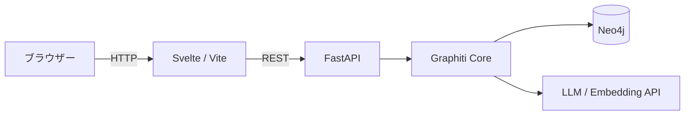

# 設計

## 構成

Docker Compose で `frontend`、`api`、`neo4j` を起動する。フロントエンドは Vite の開発サーバー、API は FastAPI、Graphiti Core は API プロセス内で利用する。Graphiti が Neo4j に時系列グラフを保存する。

## API

### `POST /api/episodes`

リクエスト: `{ "text": "投入するテキスト" }`

処理: テキストを Graphiti の `add_episode` に渡す。エピソード名は固定のサンプル名、エピソード種別は text、`group_id` は `default` とする。

レスポンス: `{ "status": "ok" }`

### `POST /api/chat`

リクエスト: `{ "message": "質問" }`

処理: Graphiti の検索 API で関連する関係・ノードを取得し、その結果から簡潔な回答文を組み立てる。チャット自体に別の LLM 呼び出しは行わない。

レスポンス: `{ "answer": "回答", "nodes": [{ "id": "...", "name": "..." }], "edges": [{ "id": "...", "source": "ノードID", "target": "ノードID", "name": "関係" }] }`

Graphiti の結果をこの画面用の JSON に変換する。ノード・関係は検索結果に含まれる範囲に限る。

## 画面

- 上部に「チャット」「データ投入」の切り替えを配置する。
- チャットは左右 1:1 程度の2ペインとする。左にメッセージ一覧と入力欄、右に SVG で描くグラフを置く。
- グラフはノードを円、関係を線とラベルで表示する。外部グラフ描画ライブラリは導入しない。
- データ投入はテキストエリア、送信ボタン、完了表示のみとする。

## Compose と設定

- `neo4j`: Neo4j 5 系、データは名前付きボリュームに保存。
- `api`: FastAPI と Graphiti Core。`OPENAI_API_KEY`、Neo4j URI / ユーザー / パスワードを環境変数で受け取る。
- `frontend`: Vite 開発サーバー。`/api` を `api` サービスへプロキシする。
- ホスト公開ポートはフロントエンド `5173`、API `8000`、Neo4j Browser `7474`。
- API 起動前に Neo4j が利用可能であることを Compose の依存関係で示す。
